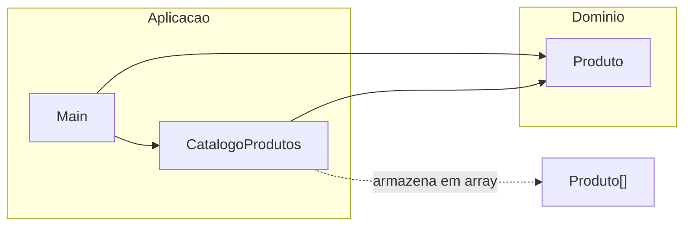
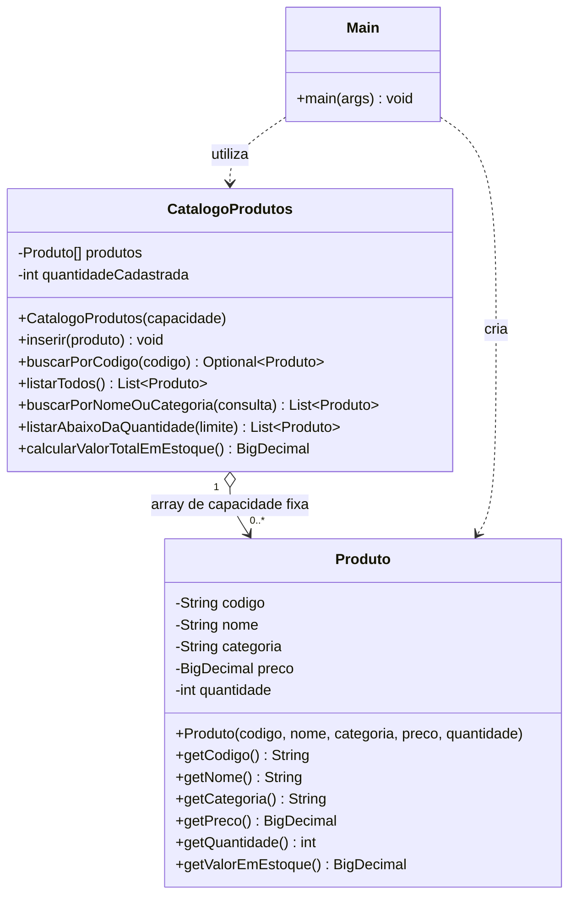
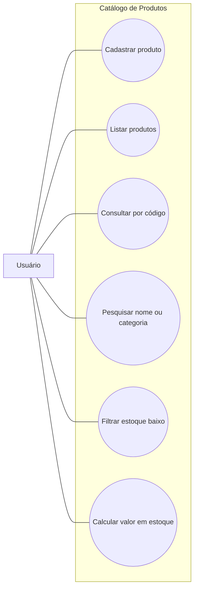
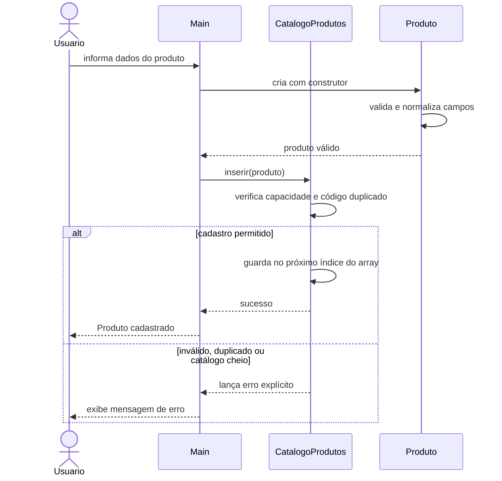
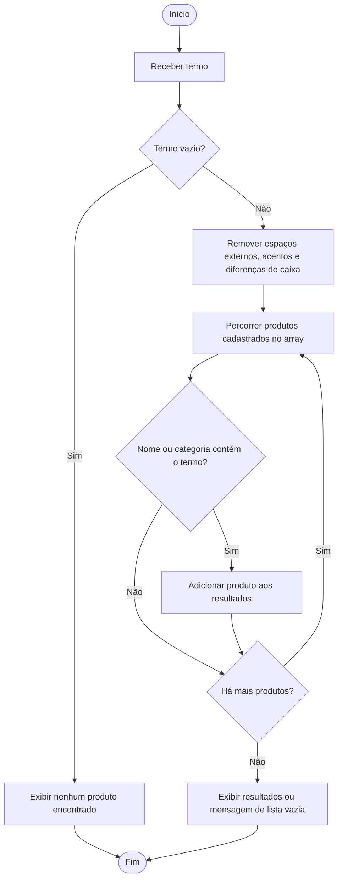

# Diagramas UML

Os diagramas abaixo usam Mermaid e podem ser visualizados no GitHub.

## Diagrama estrutural: pacotes e dependencias

## Diagrama de classes

## Diagrama comportamental: casos de uso

## Diagrama comportamental: sequência de cadastro

## Diagrama comportamental: atividade de pesquisa

